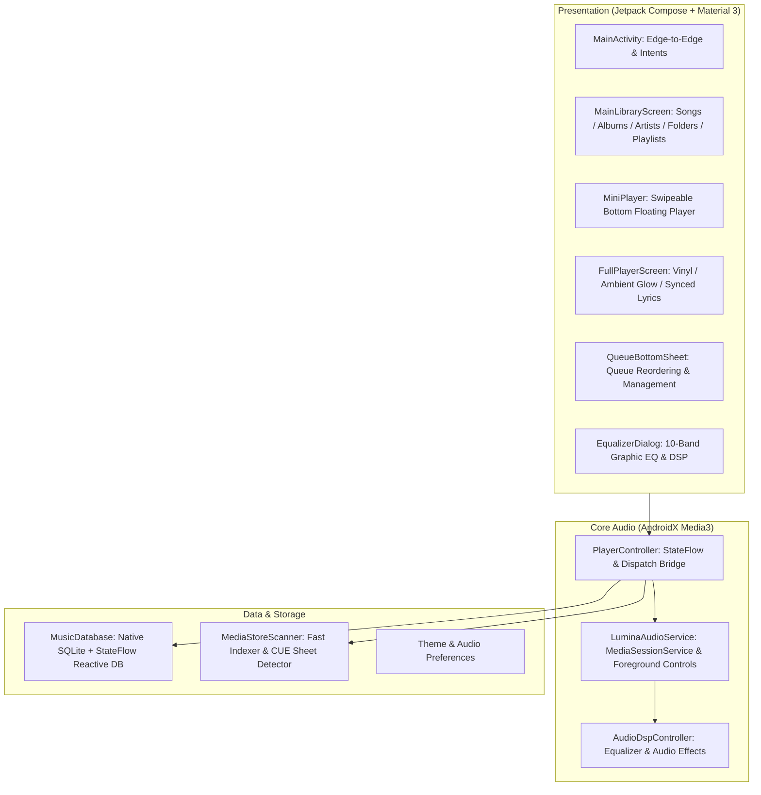

# Lumina Player (星辉音乐)

<p align="center">
  
  
  
  
  
  
  
  
</p>

<p align="center">
  <b>A Minimalist, Modern, Audiophile-Grade Local Music Player for Android</b><br/>
  <i>100% Pure Kotlin · Comprehensive Hi-Res Decoders · CUE Sheet Splitting · Synced Lyrics · 10-Band EQ · Zero Ads · Zero Telemetry</i>
</p>

<p align="center">
  <b>English</b> | <a href="doc/README_CN.md">简体中文</a>
</p>

---

## 🌟 Key Features

### 🎧 Comprehensive Audio Formats (Lossy to Hi-Res)
- **High-Resolution Lossless**: Native support for **FLAC** (up to 32-bit / 192 kHz), **ALAC**, **WAV** (Float/PCM), and **AIFF**;
- **Audiophile Formats**: Full playback support for **APE** (Monkey's Audio), **WavPack** (.wv), and **DSD** (.dsf / .dff);
- **Standard Lossy**: Clean rendering for **MP3**, **AAC**, **OGG Vorbis**, **Opus**, and **WMA**;
- **Bit-Perfect Output**: High-resolution AudioTrack pipeline with automatic format detection and Hi-Res badges.

### 📜 CUE Sheet Virtual Track Splitting
- **Zero Physical Slicing**: Automatically detects accompanying `.cue` files for single-file FLAC/APE albums and generates precise virtual tracks in memory;
- **Seamless Seeking**: Fast and click-free navigation between individual tracks with metadata mapped directly to the parent lossless file.

### 🎤 Synchronized Dynamic Lyrics
- **Real-Time Scrolling**: Smooth auto-scrolls to the current vocal timestamp;
- **Tap to Seek**: Tap any line in the lyrics to immediately jump playback to that exact second;
- **Offset Calibration**: In-app ±0.5s fine-tuning controls to fix timing drifts in external `.lrc` files.

### 🎛️ Audiophile DSP & 10-Band Equalizer
- **10-Band Graphic EQ**: System-level audio session integration with frequency-specific controls;
- **Rich Presets**: Tailored sound profiles for Flat, Rock, Pop, Jazz, Classical, and Heavy Metal;
- **Bass Boost & Virtualizer**: 3D spatial sound and bass punch customization;
- **Sleep Timer with Soft Fade-Out**: Automatic shutoff with a 10-second volume fade curve to avoid abrupt silence.

### 🌓 Lumina Design System (Pure Black & Dynamic Glow)
- **Slate Charcoal (Soft Dark)**: Eye-care dark palette tailored for night sessions;
- **AMOLED Pure Black**: Complete `#000000` dark mode for battery savings on OLED screens;
- **Ambient Flow Glow**: Dynamically tinted gradient backgrounds derived from album art colors;
- **Fluid Gestures**: Interactive Mini Player bar with swipe-to-switch and pull-up fullscreen expansion.

### 📱 Desktop Playback Widget
- **Home Screen Control**: Clean Material 3 style desktop widget displaying current track title, artist, and playback status with interactive Play/Pause, Previous, and Next buttons.

### 🛡️ Pure Offline & Zero Tracking
- **No Internet Required**: 100% offline, zero network requests, zero telemetry, and zero ads.

---

## 🏗️ Architecture Overview



---

## 🛠️ Technology Stack

| Component | Technology | Description |
| :--- | :--- | :--- |
| **Language** | Kotlin 2.2.x | 100% Kotlin codebase, JVM 17 target |
| **UI Framework** | Jetpack Compose + Material 3 | Declarative, Edge-to-Edge, Predictive Back |
| **Media Engine** | AndroidX Media3 1.5.x | `media3-exoplayer` & `media3-session` |
| **Asynchronous** | Coroutines & StateFlow | Reactive Unidirectional Data Flow (UDF) |
| **Local Storage** | Native SQLite + StateFlow | Zero-reflection, high-performance database |
| **Build System** | Gradle 9.6.0 + Version Catalog | Modern Kotlin DSL (`build.gradle.kts`) |

---

## 🚀 Getting Started

### Prerequisites
- Android Studio Ladybug / Meerkat (or newer)
- JDK 17 or JDK 21
- Android SDK 36 (Android 16 preview / Android 15 compatible, MinSdk 26 - Android 8.0+)

### Building from Source

```bash
# Clone the repository
git clone https://github.com/eddyflame/lumina-player.git
cd lumina-player

# Build Debug APK
./gradlew assembleDebug

# Run Unit Tests
./gradlew test

# Build Release APK
./gradlew assembleRelease
```

The compiled release APK will be located at:
`app/build/outputs/apk/release/lumina-player.apk`

---

## 🤝 Contributing & Community

We welcome contributions from developers, designers, and audiophiles!
- Review [CONTRIBUTING.md](CONTRIBUTING.md) for build steps, branch conventions, and testing requirements.
- Check [ARCHITECTURE.md](doc/ARCHITECTURE.md) to understand the codebase and audio engine architecture.
- Please adhere to our [Code of Conduct](CODE_OF_CONDUCT.md).
- Security policy and vulnerability reports are outlined in [SECURITY.md](SECURITY.md).

---

## 📄 License

Lumina Player is licensed under the [GNU General Public License v3.0 (GPLv3)](LICENSE).
