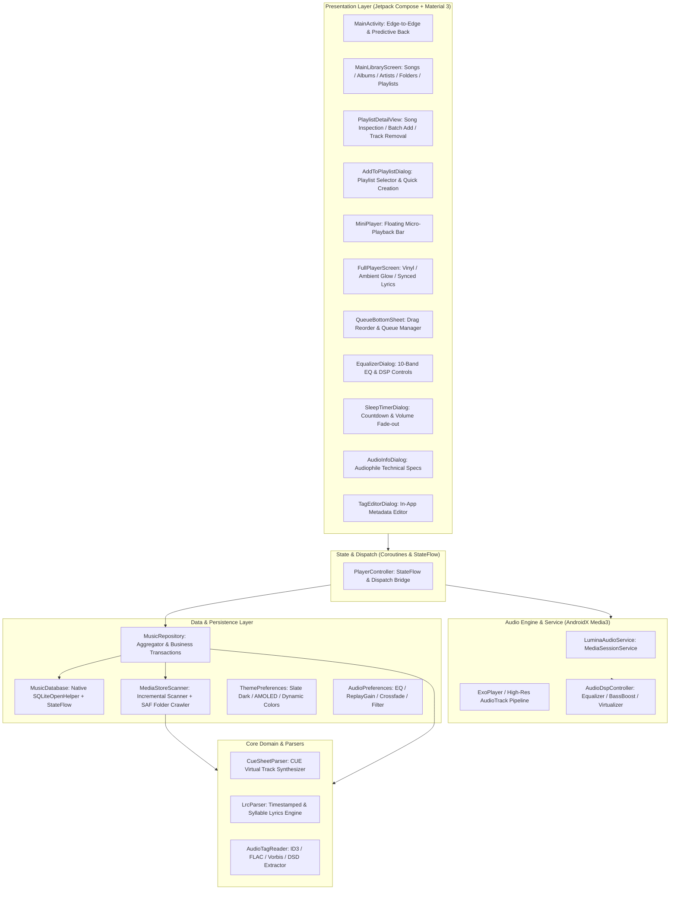

# Lumina Player Architecture & Technical Design

## 1. System Overview

**Lumina Player** is a 100% pure Kotlin, audiophile-grade local music player designed for Android. As a sister project to **Lumina Reader**, it inherits the Lumina brand design language, engineering standards, and philosophy: zero ads, zero background telemetry, offline-first privacy, and fluid modern interactions.

---

## 2. High-Level Architecture

The project adheres to Clean Architecture and Unidirectional Data Flow (UDF) principles:

---

## 3. Audio Decoding & Format Support Matrix

Lumina Player is engineered to support the widest possible spectrum of local audio formats:

| Category | File Formats | Codec & Container Processing |
| :--- | :--- | :--- |
| **Lossy** | MP3, AAC (.m4a), OGG Vorbis, Opus, WMA | Hardware MediaCodec + Media3 native extractors |
| **Lossless** | FLAC (up to 32-bit / 192 kHz), ALAC, WAV, AIFF | High-resolution AudioTrack output with bit-perfect PCM pipeline |
| **Audiophile** | APE (Monkey's Audio), WavPack (.wv), DSD (.dsf, .dff) | Pure Kotlin DSD Chunk / ID3 extractor + High-Res conversion |
| **Cue Sheet** | `.cue` + `.flac` / `.ape` / `.wav` | Pure Kotlin CUE state-machine parsing; virtual track synthesis without splitting physical files |
| **Lyrics** | `.lrc` (standalone file & embedded USLT/SYLT) | Binary search timestamp matching, line highlights, tap-to-seek, offset calibration |

---

## 4. Key Architectural Subsystems

### 4.1 Media3 Audio Service & Audio Focus
* **`LuminaAudioService`**: Implements `androidx.media3.session.MediaSessionService`, managing player lifecycle, system notification controls, lock screen metadata, and headset buttons.
* **Audio Focus & Unplug Handling**: Automatic audio focus acquisition with ducking, and immediate auto-pause on headphone disconnection (`handleAudioBecomingNoisy = true`).
* **Clipping Configuration for CUE Tracks**: For virtual CUE songs, `MediaItem.ClippingConfiguration` precisely boundaries playback to `startMs` and `endMs` seamlessly.

### 4.2 DSP, Audio Effects & Multi-Tier Anti-Pop Engine
* **Preallocated Fixed Audio Session ID**: Generates an explicit `audioSessionId` via `AudioManager` on service startup and attaches `AudioDspController` effects synchronously prior to stream initialization, eliminating runtime HAL effect chain insertion glitches.
* **Cold-Start Buffer Stagnation Elimination**: Prevents pre-decoding or pre-buffering audio into Android's `AudioTrack` ring buffer on cold start / state restoration while playback is stopped. ExoPlayer is prepared strictly when the user initiates playback.
* **Flush-on-Resume Buffer Sanitation**: Resuming paused playback executes `seekTo(pos)` to discard stale, frozen PCM samples left inside the hardware `AudioTrack` buffer during DAC sleep/standby, preventing frozen DC-offset step pops.
* **Hardware Silence Padding & Direct PCM Hann Envelope Processor**: `VisualizerAudioProcessor` enforces a dual-stage anti-pop protection envelope directly onto raw decoded PCM frames (16-bit, 24-bit, 32-bit, and Float) upon stream startup, unpause, flush, seek, or stream starvation (>80ms inter-buffer gap):
  * **20ms Pure Silence Padding**: Injects initial zero-amplitude samples to prime Android's `AudioTrack` hardware ring buffer, eliminating startup underrun stalls (`device stall time corrected`), stabilizing the DAC power amplifier rail, and allowing Bluetooth A2DP / audio routing changes to complete silently.
  * **35ms Raised-Cosine (Hann) Gain Ramp**: Directly scales post-padding PCM samples from 0.0 to 1.0 with continuous zero initial derivative ($C^1$ continuity), preventing volume zipper noise and discrete AudioFlinger mixer step quantization clicks.
* **Constant Hardware Master Volume**: Eliminates coroutine-based discrete stepping of `player.volume` across AudioFlinger mixer multiplier jumps, keeping hardware stream gain smooth.
* **10-Band Graphic Equalizer & Standard Presets (`EqPresets`)**: Connects to the active Android `audioSessionId` with instant preset synchronization and tolerance-based fuzzy curve detection across 7 standard acoustic profiles (Flat, Rock, Pop, Jazz, Classical, Metal, HipHop).
* **Deterministic O(1) Shuffle & Queue Protection**: Uniform random next index mapping guarantees zero infinite re-roll loops and prevents selecting the currently active track.
* **Zero-Strength HAL Passthrough & Cold-Start EQ Initialization**: Preserves user-selected EQ preset (`eqPreset`) across process death via `initSettings(enabled, presetId, ...)` and initializes bands cleanly without querying uninitialized hardware registers. When "Flat" preset (0 mB across all bands) or zero strength is requested, effects (Equalizer, BassBoost, Virtualizer) remain disabled in AudioFlinger, completely preventing HAL volume intercept collisions and IIR filter startup impulse shock on cold start while retaining ~60ms smooth step interpolation during slider adjustments.
* **Sleep Timer with Soft Fade-Out**: In the last 10 seconds of countdown, master volume gently interpolates down to zero before pausing playback, ensuring comfortable transitions.
* **Playback Mode & State Persistence**: Seamlessly restores play mode (repeat/shuffle), track index, and position on app restart without premature audio pipeline allocation.
* **Dynamic Siri Ambient Fluid Aura Backdrop**:
  * Employs authentic **Apple Siri / Apple Intelligence** glowing fluid orb dynamics with pure saturated neon jewel tones (Electric Cyan `#00E5FF`, Vivid Magenta `#FF2D55`, Royal Violet `#7000FF`, Luminous Amber `#FF9500`, and a central ethereal luminescence core).
  * Driven by a frame-clock monotonic time integration engine (`withFrameNanos`) and continuous harmonic trigonometric functions, completely eliminating periodic restart resets, boundary discontinuities, and visual jerks/twitches.
  * Integrated as an ambient living backdrop behind both the rotating Vinyl Disc and synchronized scrolling Lyrics in `FullPlayerScreen`, dynamically fading opacity (`0.85` for Vinyl halo corona, `0.60` for soft readable Lyrics backdrop) while streamlining view navigation (`VINYL_DISC` ⇋ `LYRICS`).

### 4.3 Zero-Reflection Reactive Persistence & Playlist Management (`MusicDatabase`)
* Avoids KSP annotation-processor brittleness across rapid Kotlin 2.x and AGP upgrades.
* Utilizes Android native `SQLiteOpenHelper` paired with Kotlin Coroutines (`Dispatchers.IO`) and reactive `StateFlow`.
* Tracks song metadata, play counts, favorites, recent playback timestamps, playlists, and playlist ordering.
* **Atomic Batch Operations & Referential Integrity**: `addSongsToPlaylist`, `removeSongsFromPlaylist`, `setFavorites`, and `resetPlayCount` execute in explicit SQLite transaction blocks (`beginTransaction()` / `setTransactionSuccessful()`), ensuring zero partial mutations and batching StateFlow update notifications to a single emission. Dead track pruning automatically purges orphaned records from `TABLE_PLAYLIST_ITEMS`.
* **In-Place Playlist Mutation & Smart Playlists**:
  * Supports real-time playlist renaming, deletion with safety verification, and dual-mode interactive playlist views (fast single-item operations & multi-select batch manipulation with library filtering) across custom playlists and system smart playlists.
  * **All Songs Smart Playlist**: Pre-seeded quick access entry providing immediate library-wide inspection, shuffle, and playback controls.
  * **Global Play Count & In-Playlist Statistics**: Tracks cumulative song play count persistently; displays song play count alongside track duration in playlist views, with one-tap batch play count reset for all songs within the active playlist.
  * **Most Played Tiered Sub-Lists**: Configurable Top 10, Top 50 (default limit), and Top 100 filtering in the Most Played smart playlist to quickly inspect and play top listening favorites.

### 4.4 Lumina Visual Identity System
* **Lumina Azure (`#0284C7`) & Music Cyan (`#38BDF8`)**: High-contrast, acoustic brand identity.
* **Slate Charcoal (`#020617` / `#0F172A`)**: Low eye-strain, soft dark theme for evening listening.
* **AMOLED Pure Black (`#000000`)**: True black OLED power efficiency.
* **Dynamic Color (Monet)**: Wall-paper-based palettes for Android 12+.
* **Ambient Mesh Glow**: Dynamically tinted gradient backgrounds in the fullscreen player.
* **Compact Lock Screen & Desktop Widget (`LuminaPlayerWidgetProvider`)**:
  * Engineered with a slim 1-row form factor (`minHeight="40dp"`, `targetCellHeight="1"`), preventing Android launchers and lock screen keyguards from expanding it to two rows.
  * Displays a prominent illuminated `LUMINA` brand identity badge in cyan (`#38BDF8`) alongside real-time track metadata and artist info.
  * Features jewel-gradient circular play controls (`#38BDF8` ➔ `#0284C7`), frosted-glass secondary action buttons, and rounded squircle album artwork rendering with memory-safe thumbnail scaling to prevent Binder `TransactionTooLargeException`.
* **Native Lockscreen Playback Controls & Xiaomi HyperOS Dynamic Island (`LuminaMediaNotificationProvider`)**:
  * **System MediaSession Integration**: Leverages standard Android `MediaStyle` notification backed by an active `MediaSession` token, ensuring full compatibility with SystemUI's `MediaControlPanel`, lock screen media carousels, and persistent playback resumption.
  * **Xiaomi HyperOS Focus & Dynamic Island Integration**: Automatically populates `miui.focus.*` notification extras (`miui.focus.enable`, `miui.focus.media`, `miui.focus.type=1`, `miui.focus.ongoing`, `miui.showActionInCompactView`, dynamic title/artist/ticker) for native HyperOS status bar pill, lock screen capsule, and dynamic island banner playback controls.
  * **Artwork & Metadata Synchronization**: Delivers album art directly via `Notification.EXTRA_LARGE_ICON` and `MediaMetadata` for crisp lock screen background and dynamic island presentation.

---

## 5. Build & CI/CD Pipeline

* **Gradle**: Gradle 9.6.0 with Kotlin DSL (`build.gradle.kts`).
* **Version Catalog**: Centralized dependency management via `gradle/libs.versions.toml`.
* **GitHub Actions Workflows**:
  * `ci.yml`: Triggers on push and pull requests targeting `main` and `develop`. Features build concurrency cancellation, executes `./gradlew testDebugUnitTest`, uploads test results as artifacts on failure or completion, builds debug APK via `./gradlew assembleDebug`, and publishes the debug APK as a downloadable artifact.
  * `release.yml`: Triggers on git tags `v*` and manual `workflow_dispatch`. Decodes base64 release keystore if provided (falls back to debug signature safely), compiles release APK, computes SHA-256 checksum, automatically publishes GitHub Releases with release notes and assets, and archives the build artifacts.
* **Open Source Standards & Community Health**:
  * Enforces LF line endings and binary protections via `.gitattributes`.
  * Provides structured GitHub Issue Forms (`bug_report.yml`, `feature_request.yml`) and Pull Request template (`PULL_REQUEST_TEMPLATE.md`).
  * Establishes formal contributor guidance (`CONTRIBUTING.md`), privacy & security declarations (`SECURITY.md`), and Contributor Covenant (`CODE_OF_CONDUCT.md`).

