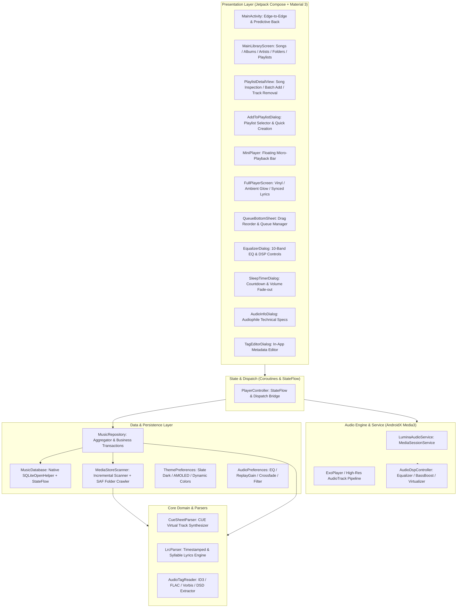

# Lumina Player Architecture & Technical Design

## 1. System Overview

**Lumina Player** is a 100% pure Kotlin, audiophile-grade local music player designed for Android. As a sister project to **Lumina Reader**, it inherits the Lumina brand design language, engineering standards, and philosophy: zero ads, zero background telemetry, offline-first privacy, and fluid modern interactions.

---

## 2. High-Level Architecture

The project adheres to Clean Architecture and Unidirectional Data Flow (UDF) principles:

---

## 3. Audio Decoding & Format Support Matrix

Lumina Player is engineered to support the widest possible spectrum of local audio formats:

| Category | File Formats | Codec & Container Processing |
| :--- | :--- | :--- |
| **Lossy** | MP3, AAC (.m4a), OGG Vorbis, Opus, WMA | Hardware MediaCodec + Media3 native extractors |
| **Lossless** | FLAC (up to 32-bit / 192 kHz), ALAC, WAV, AIFF | High-resolution AudioTrack output with bit-perfect PCM pipeline |
| **Audiophile** | APE (Monkey's Audio), WavPack (.wv), DSD (.dsf, .dff) | Pure Kotlin DSD Chunk / ID3 extractor + High-Res conversion |
| **Cue Sheet** | `.cue` + `.flac` / `.ape` / `.wav` | Pure Kotlin CUE state-machine parsing; virtual track synthesis without splitting physical files |
| **Lyrics** | `.lrc` (standalone file & embedded USLT/SYLT) | Binary search timestamp matching, line highlights, tap-to-seek, offset calibration |

---

## 4. Key Architectural Subsystems

### 4.1 Media3 Audio Service & Audio Focus
* **`LuminaAudioService`**: Implements `androidx.media3.session.MediaSessionService`, managing player lifecycle, system notification controls, lock screen metadata, and headset buttons.
* **Audio Focus & Unplug Handling**: Automatic audio focus acquisition with ducking, and immediate auto-pause on headphone disconnection (`handleAudioBecomingNoisy = true`).
* **Clipping Configuration for CUE Tracks**: For virtual CUE songs, `MediaItem.ClippingConfiguration` precisely boundaries playback to `startMs` and `endMs` seamlessly.

### 4.2 DSP, Audio Effects & Multi-Tier Anti-Pop Engine
* **Preallocated Fixed Audio Session ID**: Generates an explicit `audioSessionId` via `AudioManager` on service startup and attaches `AudioDspController` effects synchronously prior to stream initialization, eliminating runtime HAL effect chain insertion glitches.
* **Master Volume Raised-Cosine Soft Ramp**: Applies a continuous Hann envelope fade-in (~42ms) when resuming or starting playback, and a smooth fade-out (~20ms) when pausing or seeking, completely eliminating DAC capacitor charging spikes and buffer step-function popping.
* **PCM Buffer Anti-Pop Processor**: `VisualizerAudioProcessor` enforces a 35ms raised-cosine gain envelope directly on decoded audio frames across 16-bit, 24-bit, 32-bit, and Float PCM encodings upon unpause, flush, or seek.
* **10-Band Graphic Equalizer**: Connects to the active Android `audioSessionId` with instant preset synchronization and custom curve detection.
* **Zero-Strength HAL Passthrough**: Effects (BassBoost, Virtualizer, Equalizer) are only activated in AudioFlinger when non-zero gain is requested, preventing HAL volume intercept collisions on cold start while retaining ~60ms smooth step interpolation during slider adjustments.
* **Sleep Timer with Soft Fade-Out**: In the last 10 seconds of countdown, master volume gently interpolates down to zero before pausing playback, ensuring comfortable transitions.
* **Playback Mode & State Persistence**: Seamlessly restores play mode (repeat/shuffle), track index, and position on app restart with muted cold-start preroll.
* **Dynamic Siri Ambient Fluid Aura Backdrop**:
  * Employs authentic **Apple Siri / Apple Intelligence** glowing fluid orb dynamics with pure saturated neon jewel tones (Electric Cyan `#00E5FF`, Vivid Magenta `#FF2D55`, Royal Violet `#7000FF`, Luminous Amber `#FF9500`, and a central ethereal luminescence core).
  * Driven by a frame-clock monotonic time integration engine (`withFrameNanos`) and continuous harmonic trigonometric functions, completely eliminating periodic restart resets, boundary discontinuities, and visual jerks/twitches.
  * Integrated as an ambient living backdrop behind both the rotating Vinyl Disc and synchronized scrolling Lyrics in `FullPlayerScreen`, dynamically fading opacity (`0.85` for Vinyl halo corona, `0.60` for soft readable Lyrics backdrop) while streamlining view navigation (`VINYL_DISC` ⇋ `LYRICS`).

### 4.3 Zero-Reflection Reactive Persistence & Playlist Management (`MusicDatabase`)
* Avoids KSP annotation-processor brittleness across rapid Kotlin 2.x and AGP upgrades.
* Utilizes Android native `SQLiteOpenHelper` paired with Kotlin Coroutines (`Dispatchers.IO`) and reactive `StateFlow`.
* Tracks song metadata, play counts, favorites, recent playback timestamps, playlists, and playlist ordering.
* **Atomic Batch Operations**: `addSongsToPlaylist`, `removeSongsFromPlaylist`, `setFavorites`, and `resetPlayCount` execute in explicit SQLite transaction blocks (`beginTransaction()` / `setTransactionSuccessful()`), ensuring zero partial mutations and batching StateFlow update notifications to a single emission.
* **In-Place Playlist Mutation & Smart Playlists**:
  * Supports real-time playlist renaming, deletion with safety verification, and dual-mode interactive playlist views (fast single-item operations & multi-select batch manipulation with library filtering) across custom playlists and system smart playlists.
  * **All Songs Smart Playlist**: Pre-seeded quick access entry providing immediate library-wide inspection, shuffle, and playback controls.
  * **Global Play Count & In-Playlist Statistics**: Tracks cumulative song play count persistently; displays song play count alongside track duration in playlist views, with one-tap batch play count reset for all songs within the active playlist.
  * **Most Played Tiered Sub-Lists**: Configurable Top 10, Top 50 (default limit), and Top 100 filtering in the Most Played smart playlist to quickly inspect and play top listening favorites.

### 4.4 Lumina Visual Identity System
* **Lumina Azure (`#0284C7`) & Music Cyan (`#38BDF8`)**: High-contrast, acoustic brand identity.
* **Slate Charcoal (`#020617` / `#0F172A`)**: Low eye-strain, soft dark theme for evening listening.
* **AMOLED Pure Black (`#000000`)**: True black OLED power efficiency.
* **Dynamic Color (Monet)**: Wall-paper-based palettes for Android 12+.
* **Ambient Mesh Glow**: Dynamically tinted gradient backgrounds in the fullscreen player.

---

## 5. Build & CI/CD Pipeline

* **Gradle**: Gradle 9.6.0 with Kotlin DSL (`build.gradle.kts`).
* **Version Catalog**: Centralized dependency management via `gradle/libs.versions.toml`.
* **GitHub Actions**:
  * `ci.yml`: Executes `./gradlew test` and `./gradlew assembleDebug` on every push and pull request.
  * `release.yml`: Triggers on git tags `v*`, signs with release keystore, and automatically publishes `lumina-player.apk` to GitHub Releases.
