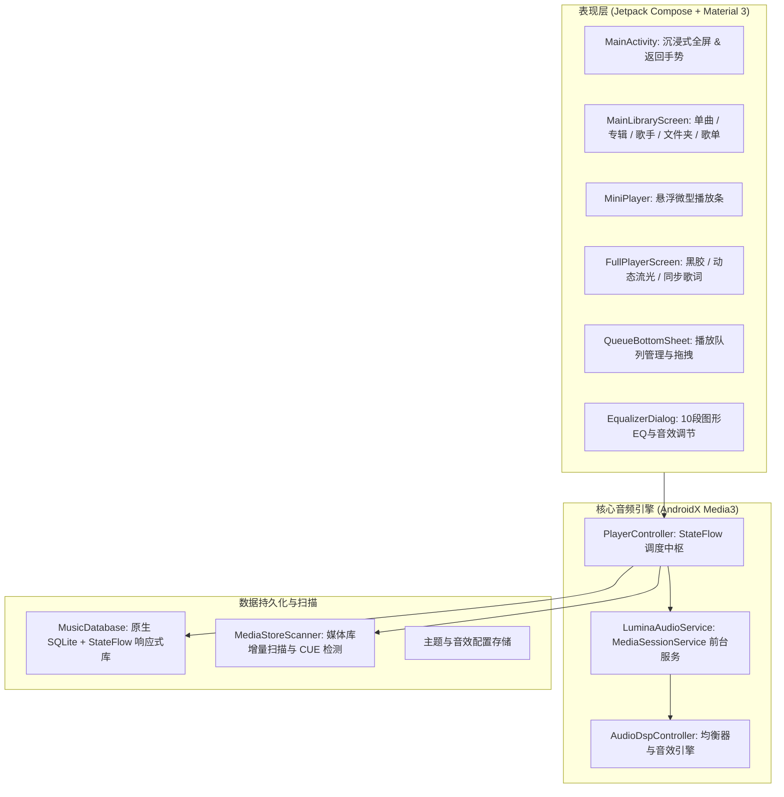

# Lumina Player (星辉音乐)

<p align="center">
  
  
  
  
  
  
</p>

<p align="center">
  <b>专注于纯粹音乐的发烧级 Android 本地音乐播放器</b><br/>
  <i>100% 纯 Kotlin · 全格式高保真解码 · CUE 智能整轨分轨 · 实时同步歌词 · 10段图形均衡器 · 零广告 · 零隐私侵犯</i>
</p>

<p align="center">
  <a href="../README.md">English</a> | <b>简体中文</b>
</p>

---

## 🌟 核心特性亮点

### 🎧 发烧级全格式音频解码
- **高解析度无损 (Hi-Res Lossless)**：原生硬解 **FLAC**（最高支持 32-bit / 192 kHz）、**ALAC**、**WAV**（PCM / 浮点 Float）与 **AIFF**；
- **发烧极客格式**：完整支持 **APE** (Monkey's Audio)、**WavPack** (.wv) 以及 **DSD** (.dsf / .dff) 高保真回放；
- **主流常见格式**：**MP3**、**AAC**、**OGG Vorbis**、**Opus** 与 **WMA**；
- **高位深输出与格式角标**：直通 Android 高解析度 AudioTrack 输出管道，自动识别并醒目标注 `Hi-Res 24bit/96kHz`、`DSD` 等音质标识。

### 📜 CUE Sheet 智能虚拟分轨
- **无需物理切割文件**：自动识别无损整轨文件（如 `album.flac` / `album.ape`）同目录下的 `.cue` 伴生文件，并在内存中智能解析映射为独立的虚拟单曲；
- **无缝定位与元数据关联**：精准跳转分轨时间戳，无需占用双倍存储空间。

### 🎤 沉浸式逐行同步歌词
- **实时同步平滑滚动**：随播放进度精准自动滚动当前歌词行；
- **点击歌词随意跳转 (Tap to Seek)**：轻触任意一行歌词，播放器即刻跳转至对应时间点；
- **时间轴微调 (±0.5s)**：内置歌词偏移校准器，轻松解决外部 `.lrc` 歌词时间轴偏差。

### 🎛️ 专业 DSP 音效与 10 段图形均衡器
- **10 段图形均衡器 (10-Band EQ)**：深度挂载系统级音频会话，支持 31Hz - 16kHz 多频段微调；
- **丰富发烧预设**：内置平直 (Flat)、摇滚 (Rock)、流行 (Pop)、爵士 (Jazz)、古典 (Classical)、重金属 (Metal) 等经典曲线；
- **重低音增强 (Bass Boost) 与 3D 虚拟环绕 (Virtualizer)**；
- **带温和淡出的睡眠定时器**：倒计时结束前 10 秒开启自动平滑音量衰减，杜绝突兀暂停惊醒睡眠。

### 🌓 Lumina 家族化美学设计 (纯黑与动态流光)
- **柔和石板灰 (Slate Dark 推荐护眼)**：专为夜间听歌优化的深蓝灰，舒适温润；
- **AMOLED 极致纯黑**：针对 OLED 屏幕优化的 `#000000` 纯黑像素，极致省电；
- **自适应流光动态渐变**：全屏播放界面实时提取封面主辅色，生成如梦如幻的流光渐变背景；
- **灵动交互手势**：全局吸附微型播放器 (Mini Player)，支持左右滑动切歌与上滑展开全屏。

### 🛡️ 纯粹离线 · 零追踪 · 零广告
- **完全本地运行**：不包含任何联网推荐、社交分享、数据追踪代码与广告 SDK，纯粹保护隐私与设备电量。

---

## 🏗️ 架构概览



---

## 🛠️ 技术栈详情

| 组件 | 技术选型 | 说明 |
| :--- | :--- | :--- |
| **编程语言** | Kotlin 2.2.x | 100% 纯 Kotlin 编写，目标 JVM 17 |
| **UI 架构** | Jetpack Compose + Material 3 | 声明式响应式 UI、Edge-to-Edge、预测性返回 |
| **播放核心** | AndroidX Media3 1.5.x | Google 官方最新的 `media3-exoplayer` 与 `media3-session` |
| **异步数据流** | Kotlin 协程 + StateFlow | 单向数据流 (UDF) 架构，响应灵敏无阻塞 |
| **本地数据库** | 原生 SQLiteOpenHelper + StateFlow | 零注解处理器依赖，极致编译性能与稳定度 |
| **构建系统** | Gradle 9.6.0 + Version Catalog | Kotlin DSL 构建脚本 (`build.gradle.kts`) |

---

## 🚀 编译与运行

### 环境要求
- Android Studio Ladybug / Meerkat (或更高版本)
- JDK 17 或 JDK 21
- Android SDK 36 (最低支持 Android 8.0 / API 26)

### 命令行编译

```bash
# 克隆仓库
git clone https://github.com/your-username/lumina-player.git
cd lumina-player

# 编译 Debug APK
./gradlew assembleDebug

# 运行单元测试
./gradlew test

# 编译 Release APK
./gradlew assembleRelease
```

编译生成的 Release 安装包位于：
`app/build/outputs/apk/release/lumina-player.apk`

---

## 📄 开源许可证

本项目基于 [GNU General Public License v3.0 (GPLv3)](../LICENSE) 开源。
